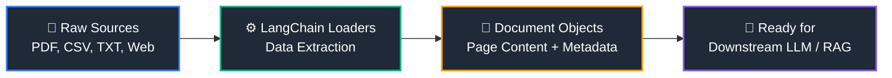

<div align="center">

  <!-- Animated Typing Header -->
  <a href="https://git.io">
    
  </a>

  <p align="center">
    <strong>A practical, hands-on implementation of LangChain Document Loaders for ingesting data from multiple sources into LLM and RAG (Retrieval-Augmented Generation) pipelines.</strong>
  </p>

  <!-- Tech Stack Badges -->
  <p align="center">
    
    
    
    
  </p>

  <!-- Animated Divider -->
  

</div>

## ✨ Overview

In any **LLM or RAG application**, raw data from different sources must be cleanly extracted and converted into standard `Document` objects. This repository provides modular, ready-to-run Python scripts demonstrating how to load PDFs, CSVs, web pages, plain text files, and entire directories using **LangChain**.



---

## 📂 Repository Structure

```text
📦 Document Loader in LangChain
 ┣ 📂 Documment Loaders/        # Core loader scripts (Text, PDF, Directory, Web, etc.)
 ┣ 📂 books/                    # Sample folder for DirectoryLoader testing
 ┣ 📜 03.Directly_loader.py     # Batch loading multiple files from a directory
 ┣ 📜 04.Web_Baseloader.py      # Scraping and loading content from web URLs
 ┣ 📜 05.csv_loader.py          # Structured CSV data ingestion script
 ┣ 📜 ai_models.csv             # Sample CSV dataset
 ┣ 📜 ai_research_document.pdf  # Research paper sample (PDF)
 ┣ 📜 ml.pdf                    # Machine Learning reference document (PDF)
 ┣ 📜 transformer_intro.txt     # Unstructured plain text sample
 ┣ 📜 requirements.txt          # Project dependencies
 ┗ 📜 .gitignore                # Environment & cache exclusions
```

---

## 🛠️ Implemented Document Loaders

| Data Source | Loader Class | Script / Reference | Description |
| :--- | :--- | :--- | :--- |
| **Plain Text** | `TextLoader` | `transformer_intro.txt` | Loads raw `.txt` files with clean encoding support. |
| **PDF Files** | `PyPDFLoader` | `ml.pdf`, `ai_research_document.pdf` | Extracts text and page-level metadata from PDFs. |
| **Directory** | `DirectoryLoader` | `03.Directly_loader.py` | Batch-loads multiple documents from the `books/` folder. |
| **Web Pages** | `WebBaseLoader` | `04.Web_Baseloader.py` | Fetches and parses text content directly from web URLs. |
| **CSV Data** | `CSVLoader` | `05.csv_loader.py` | Converts rows from `ai_models.csv` into LangChain `Document` objects. |

---

## 🚀 Quick Start Guide

### 1️⃣ Clone the Repository
```bash
git clone https://github.com<your-username>/<your-repo-name>.git
cd "Document Loader & Text Splitter in langchain"
```

### 2️⃣ Set Up a Virtual Environment
```bash
python -m venv venv

# Windows
venv\Scripts\activate

# macOS / Linux
source venv/bin/activate
```

### 3️⃣ Install Dependencies
```bash
pip install -r requirements.txt
```

### 4️⃣ Configure Environment Variables
Create a `.env` file in the root folder and add your API key:
```env
OPENAI_API_KEY=your_api_key_here
```

### 5️⃣ Run Any Loader Script
```bash
python 05.csv_loader.py
```

---

<div align="center">
  
  <p>⭐ <strong>If you find this repository helpful for learning LangChain, consider giving it a star!</strong> ⭐</p>
</div>
